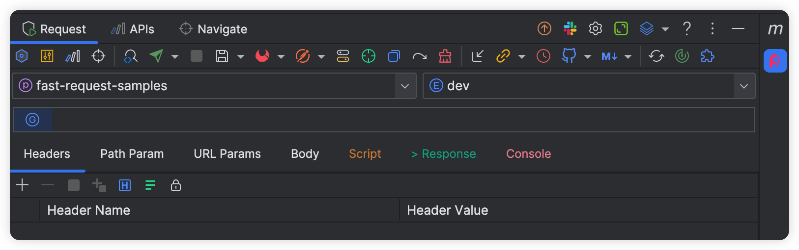

# Features

The icon in the document corresponds to the button icon in the plugin

[Interface guide](../ui-guide.md): Find features in the plugin interface and click a button to open its documentation.

## Request

### Request Debugging

- [<ColorIcon icon="sendNew" /> Debug API & send request](./debugApi.md)
- [<ColorIcon icon="stop" /> Stop API request](./stopRequest.md)
- [<ColorIcon icon="sendDownloadNew" /> Download file](./downloadApi.md)
- [<ColorIcon icon="regenerate" /> Re generate](./regenerate.md)
- [<ColorIcon icon="clearNew" /> Clear](./clear.md)

### Request Saving and Reuse

- [<ColorIcon icon="save" /> Save request](./saveRequest.md)
- [<ColorIcon icon="saveGroup" /> Save API parameter group](./apiGroup.md)
- [<ColorIcon icon="apiParamGroupNew" /> Switch API parameter group](./apiGroup.md)
- [<ColorIcon icon="saveTemp" /> Temporary request](./tempRequest.md)
- [<ColorIcon icon="historyNew" /> History request](./historyRequest.md)

### Parameter Generation and AI

- [<ColorIcon icon="openai" /> AI Parameter Optimization](./aiParameterOptimization.md)
- [<ColorIcon icon="function" /> Function](./function.md)
- [<ColorIcon icon="settings" /> AI Settings](./ai.md)

### Environment and Configuration

- [<ColorIcon icon="domainConfigNew" /> Project-level domain config](./projectLevelDomainConfig.md)
- [<ColorIcon icon="quanjucanshu" /> Project-level config](./projectValueConfig.md)
- [<ColorIcon icon="environment" /> Environment](./environment.md)
- [<ColorIcon icon="restfulFastRequest" /> Auto domain](./autoDomain.md)
- [<ColorIcon icon="settings" /> Setting manager](./settingManager.md)
- [<ColorIcon icon="rcd-refresh" /> Project config refresh](./projectConfigRefresh.md)

### Import and Integrations

- [<ColorIcon icon="import" /> cURL import](./curlImport.md)
- [<ColorIcon icon="curl1" /> cURL copy](./copyCurl.md)
- [<ColorIcon icon="urlCopy" /> Single url copy](./copyUrl.md)
- [<ColorIcon icon="apifox" /> Apifox integration](./apifox.md)
- [<ColorIcon icon="postmanNew" /> Postman integration](./postmanSync.md)

### Documentation and Sharing

- [<ColorIcon icon="doc" /> Online Document](./onlineDocument.md)
- [<ColorIcon icon="github" /> <ColorIcon icon="gitee" /> <ColorIcon icon="gitlab" /> API document sync](./apiDocSync.md)
- [<ColorIcon icon="markdown" /> API document export](./shareApiDoc.md)
- [<ColorIcon icon="openApi" /> OpenAPI export](./openApi.md)
- [<ColorIcon icon="settings" /> Markdown doc template config](./markdownDocTemplateConfig.md)

### Headers and Authentication

- [<ColorIcon icon="headerGroupNew" /> Header group](./headerGroup.md)
- [<ColorIcon icon="headersPreset" /> Headers Preset](./headersPreset.md)
- [<ColorIcon icon="commonHeaderNew" /> Common header](./commonHeader.md)
- [<ColorIcon icon="bulkEdit" /> Headers batch edit](./commonHeader.md)
- [<ColorIcon icon="lock" /> Basic Auth](./basicAuth.md)

### Workspace and Utilities

- [<ColorIcon icon="searchApi" /> SearchEveryWhere](./searchEveryWhere.md)
- [<ColorIcon icon="locate" /> Navigate to current method](./navigateCurrentMethod.md)
- [<ColorIcon icon="storeData" /> Multi tab window](./navigateCurrentMethodJson.md)
- [<ColorIcon icon="customToolbar" /> Custom toolbar](./customToolbar.md)
- [<ColorIcon icon="fullScreen" /> Full screen](./fullScreen.md)
- [<ColorIcon icon="restfulFastRequest" /> Make icon move](./makeIconMove.md)
- [<ColorIcon icon="analyseNew" /> Annual report](./annualReport.md)
- [<ColorIcon icon="doc" /> Document / Contact](./docAndContact.md)
- [<ColorIcon icon="license" /> EULA](../eula.md)

## Apis

- [<ColorIcon icon="apis" /> API list](./apiList.md)
- [<ColorIcon icon="postman" /> APIs export to Postman](./apiToPostman.md)
- [<ColorIcon icon="export" /> APIs import and export](./apiImportExport.md)
- [<ColorIcon icon="markdown" /> Batch export API doc](./batchExportApiDoc.md)

## Navigate

- [<ColorIcon icon="locateNavigate" /> API navigate tree](./apiNavigateTree.md)

## RunMethod

- [<ColorIcon icon="runMethod" /> Run Method](./runMethod.md)

## Methods

- [<ColorIcon icon="method_dark" /> Methods](./runMethod.md#methods)

## Generate

- [<ColorIcon icon="apis" /> Batch API Generation](./batchGenerateApi.md)
- [<ColorIcon icon="swagger" /> Swagger default value parsing support](./swaggerDefaultValueParse.md)
- [<ColorIcon icon="java" /> Auto Description](./autoDescription.md)

## Editor

- [<ColorIcon icon="restfulFastRequest" /> Project-level domain quick config](./projectLevelDomainConfig.md)
- [<ColorIcon icon="restfulFastRequest" /> API list preview](./apiPreview.md)
- [<ColorIcon icon="class" /> Api comment preview](./apiCommentPreview.md)
- [<ColorIcon icon="field_dark" /> Parse strategy](./parseStrategy.md)

## Script

- [<ColorIcon icon="scriptNew" /> Script](./script.md)

## Other

- [<ColorIcon icon="add1" /> Quickly add header](./quickAddHeader.md)
- [<ColorIcon icon="json" /> Json grammar check](./jsonGrammarCheck.md)
