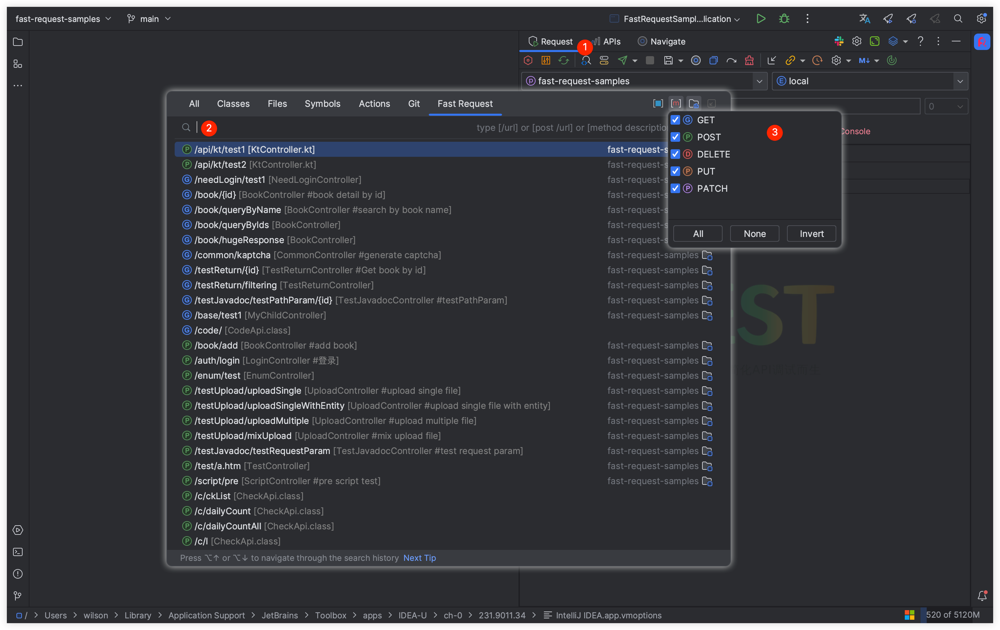

# SearchEveryWhere

Search for APIs by URL, HTTP method, or API description.

```
Example:
/url              (search by url)
get /list         (search by get method and url)
post /save        (search by post method and url)
description keywords  (search by keywords)
```



## Supported URL formats <Badge text="2026.1.4" type="info"/>

For an endpoint declared as `GET /api/orders/{id}/detail`, all of the following inputs can find it:

| URL format | Search example |
| --- | --- |
| Full endpoint path | `/api/orders/{id}/detail` |
| Numeric path parameter | `/api/orders/123/detail` |
| String path parameter | `/api/orders/order-abc/detail` |
| URL with a host and port | `http://localhost:8080/api/orders/123/detail` |
| HTTPS URL | `https://example.com/api/orders/123/detail` |
| Context path or gateway prefix | `/gateway/order-service/api/orders/123/detail` |
| Host and context path combined | `https://example.com/order-service/api/orders/123/detail` |
| Query parameters | `/api/orders/123/detail?name=jack&size=10` |
| Fragment | `/api/orders/123/detail#response` |
| Omitted endpoint path prefix | `/orders/123/detail` |
| Incomplete final static segment | `/api/orders/123/deta` |
| HTTP method included | `GET /api/orders/123/detail?name=jack` |

Surrounding whitespace is trimmed. The host, port, query parameters, and fragment do not participate in path matching. An input can include an HTTP method, host, context path, and query parameters together, for example: `GET https://example.com/order-service/api/orders/123/deta?name=jack`.

Whole-segment placeholders such as `{id}` and `{name}` accept numbers, strings, UUIDs, and other parameter values. Each placeholder matches one non-empty path segment without crossing `/`. Multiple path parameters are supported: `/shops/main-store/orders/123/detail` can match `/shops/{shopCode}/orders/{id}/detail`.

Embedded placeholders such as `{name}.json` are not currently supported. For endpoints with a trailing static segment, include that segment when searching with actual parameter values. For example, `/api/orders/123/deta` can match, while `/api/orders/123` alone is not currently supported.

## Search URLs with a context path <Badge text="2026.1.1" type="info"/>

When a search path contains prefixes such as a `context-path` or gateway path that are not declared in the Controller mapping, SearchEveryWhere automatically tries matching path suffixes against APIs in the project. No truncation configuration is required.

For example, searching for `/gateway/user-service/users/{id}` can match the Controller mapping `/users/{id}`. The same behavior applies when an HTTP method is included, such as `GET /gateway/user-service/users/{id}`, while method filtering is preserved.
