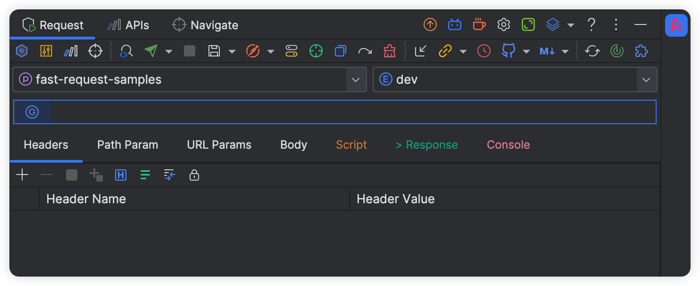

# 功能列表

文档中的图标对应插件中的按钮图标，大标题对应 tab 以及功能

[界面导览](../ui-guide.md)：按插件界面查找功能，点击按钮打开对应文档。

## Request

### 请求调试

- [<ColorIcon icon="sendNew" /> 调试 API 发送请求](./debugApi.md)
- [<ColorIcon icon="stop" /> 终止 API 请求功能](./stopRequest.md)
- [<ColorIcon icon="sendDownloadNew" /> 下载文件](./downloadApi.md)
- [<ColorIcon icon="regenerate" /> 重新生成请求](./regenerate.md)
- [<ColorIcon icon="clearNew" /> 清除](./clear.md)

### 请求保存与复用

- [<ColorIcon icon="save" /> 保存请求](./saveRequest.md)
- [<ColorIcon icon="saveGroup" /> API 参数分组保存](./apiGroup.md)
- [<ColorIcon icon="apiParamGroupNew" /> API 参数分组切换](./apiGroup.md)
- [<ColorIcon icon="saveTemp" /> 临时请求](./tempRequest.md)
- [<ColorIcon icon="historyNew" /> 历史请求预览](./historyRequest.md)

### 参数生成与 AI

- [<ColorIcon icon="openai" /> AI 参数智能优化](./aiParameterOptimization.md)
- [<ColorIcon icon="function" /> 函数](./function.md)
- [<ColorIcon icon="settings" /> AI 设置](./ai.md)

### 环境与配置

- [<ColorIcon icon="domainConfigNew" /> 项目域名配置](./projectLevelDomainConfig.md)
- [<ColorIcon icon="quanjucanshu" /> 项目级别全局参数支持](./projectValueConfig.md)
- [<ColorIcon icon="environment" /> Environment](./environment.md)
- [<ColorIcon icon="restfulFastRequest" /> 自动域名](./autoDomain.md)
- [<ColorIcon icon="settings" /> 管理配置](./settingManager.md)
- [<ColorIcon icon="rcd-refresh" /> 项目配置刷新](./projectConfigRefresh.md)

### 导入与集成

- [<ColorIcon icon="import" /> cURL 导入](./curlImport.md)
- [<ColorIcon icon="curl1" /> cURL 拷贝](./copyCurl.md)
- [<ColorIcon icon="urlCopy" /> 一键拷贝 Url](./copyUrl.md)
- [<ColorIcon icon="apifox" /> Apifox 集成](./apifox.md)
- [<ColorIcon icon="postmanNew" /> Postman 集成](./postmanSync.md)

### 文档与分享

- [<ColorIcon icon="doc" /> 在线文档](./onlineDocument.md)
- [<ColorIcon icon="github" /> <ColorIcon icon="gitee" /> <ColorIcon icon="gitlab" /> API 文档同步](./apiDocSync.md)
- [<ColorIcon icon="markdown" /> API 文档导出](./shareApiDoc.md)
- [<ColorIcon icon="openApi" /> OpenAPI 导出](./openApi.md)
- [<ColorIcon icon="settings" /> Markdown 文档模板配置](./markdownDocTemplateConfig.md)

### 请求头与认证

- [<ColorIcon icon="headerGroupNew" /> Headers 分组](./headerGroup.md)
- [<ColorIcon icon="headersPreset" /> Headers 预设](./headersPreset.md)
- [<ColorIcon icon="commonHeaderNew" /> 常用头参数](./commonHeader.md)
- [<ColorIcon icon="bulkEdit"/> Headers 批量编辑](./bulkEdit.md)
- [<ColorIcon icon="lock" /> Basic Auth](./basicAuth.md)

### 工作区与辅助

- [<ColorIcon icon="searchApi" /> SearchEveryWhere](./searchEveryWhere.md)
- [<ColorIcon icon="locate" /> 当前方法定位](./navigateCurrentMethod.md)
- [<ColorIcon icon="storeData" /> 多窗口 Tab](./navigateCurrentMethodJson.md)
- [<ColorIcon icon="customToolbar" /> 自定义工具栏](./customToolbar.md)
- [<ColorIcon icon="fullScreen" /> 全屏](./fullScreen.md)
- [<ColorIcon icon="restfulFastRequest" /> 让图标动起来](./makeIconMove.md)
- [<ColorIcon icon="analyseNew" /> 年度报告](./annualReport.md)
- [<ColorIcon icon="doc" /> 文档/快速联系](./docAndContact.md)
- [<ColorIcon icon="license" /> EULA](../eula.md)

## Apis

- [<ColorIcon icon="apis" /> API 列表](./apiList.md)
- [<ColorIcon icon="postman" /> API 导出到 Postman](./apiToPostman.md)
- [<ColorIcon icon="export" /> APIs 导入导出](./apiImportExport.md)
- [<ColorIcon icon="markdown" /> 批量导出 API 文档](./batchExportApiDoc.md)

## Navigate

- [<ColorIcon icon="locateNavigate" /> API 导航树](./apiNavigateTree.md)

## RunMethod

- [<ColorIcon icon="runMethod" /> Run Method](./runMethod.md)

## Methods

- [<ColorIcon icon="method_dark" /> Methods](./runMethod.md#methods)

## Generate

- [<ColorIcon icon="apis" /> 批量生成 API](./batchGenerateApi.md)
- [<ColorIcon icon="swagger" /> Swagger 默认值](./swaggerDefaultValueParse.md)
- [<ColorIcon icon="java" /> API 自动生成注释](./autoDescription.md)

## Editor

- [<ColorIcon icon="restfulFastRequest" /> 项目域名快速配置](./projectLevelDomainConfig.md)
- [<ColorIcon icon="restfulFastRequest" /> API 一览表预览](./apiPreview.md)
- [<ColorIcon icon="class" /> Api 注释预览](./apiCommentPreview.md)
- [<ColorIcon icon="field_dark" /> 解析策略](./parseStrategy.md)

## Script

- [<ColorIcon icon="scriptNew" /> 脚本](./script.md)

## Other

- [<ColorIcon icon="add1" /> 快速添加 header](./quickAddHeader.md)
- [<ColorIcon icon="json" /> Json 语法检查](./jsonGrammarCheck.md)
