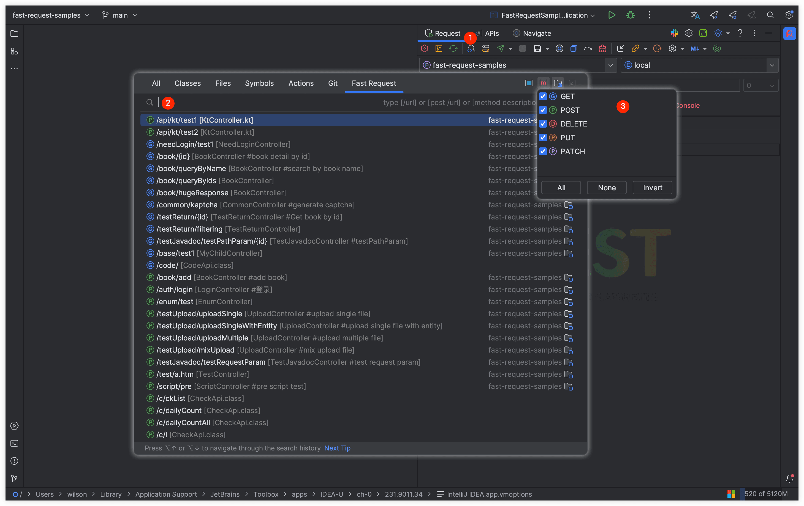

# SearchEveryWhere

支持通过 URL、HTTP 方法或接口描述快速搜索 API。

```
输入案例
/url              (查询指定url)
get /list         (指定get方式指定url)
post /save        (指定post方式指定url)
方法关键字          (查询指定描述)
```



## 支持的 URL 类型&#x20;

以接口 `GET /api/orders/{id}/detail` 为例，以下输入都可以匹配该接口：

| URL 类型 | 搜索示例 |
| --- | --- |
| 完整接口路径 | `/api/orders/{id}/detail` |
| 数字路径参数 | `/api/orders/123/detail` |
| 字符串路径参数 | `/api/orders/order-abc/detail` |
| 带域名和端口的 URL | `http://localhost:8080/api/orders/123/detail` |
| HTTPS URL | `https://example.com/api/orders/123/detail` |
| 带 context-path 或网关前缀 | `/gateway/order-service/api/orders/123/detail` |
| 域名与 context-path 组合 | `https://example.com/order-service/api/orders/123/detail` |
| 带 Query 参数 | `/api/orders/123/detail?name=jack&size=10` |
| 带 fragment | `/api/orders/123/detail#response` |
| 省略接口路径前缀 | `/orders/123/detail` |
| 最后一个固定路径段未输完 | `/api/orders/123/deta` |
| 同时指定 HTTP 方法 | `GET /api/orders/123/detail?name=jack` |

搜索会自动去除输入首尾的空白；域名、端口、Query 参数和 fragment 不参与路径匹配。例如，也可输入 `GET https://example.com/order-service/api/orders/123/deta?name=jack`，同时指定请求方法、域名、context-path 和 Query 参数。

`{id}`、`{name}` 等整段占位符支持数字、字符串、UUID 等参数值，每个占位符匹配一个非空路径段，不跨越 `/`。多个路径参数也支持，例如 `/shops/main-store/orders/123/detail` 可以匹配 `/shops/{shopCode}/orders/{id}/detail`。

当前不支持 `{name}.json` 这类段内占位符。对于上述带固定尾段的接口，使用实际参数值搜索时，需要一并输入后续固定路径段，例如 `/api/orders/123/deta` 可以匹配，单独输入 `/api/orders/123` 暂不支持。

## 搜索带 context-path 的 URL&#x20;

当搜索路径包含 `context-path`、网关路径等前缀，而 Controller 中声明的路径不包含这些前缀时，SearchEveryWhere 会自动尝试使用路径后缀匹配项目中的 API，无需额外配置截断片段。

例如，搜索 `/gateway/user-service/users/{id}` 时，可以匹配 Controller 中声明的 `/users/{id}`。带 HTTP 方法搜索同样支持该能力，例如 `GET /gateway/user-service/users/{id}`，并且仍会按照 HTTP 方法过滤结果。
